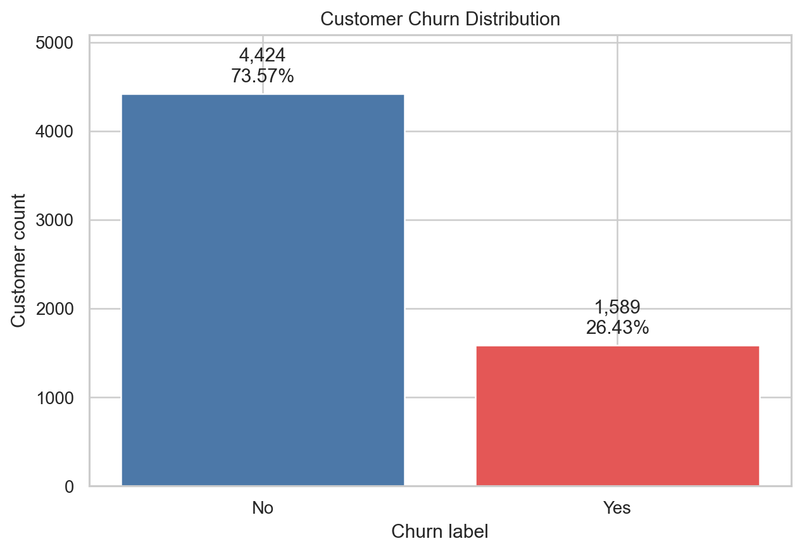
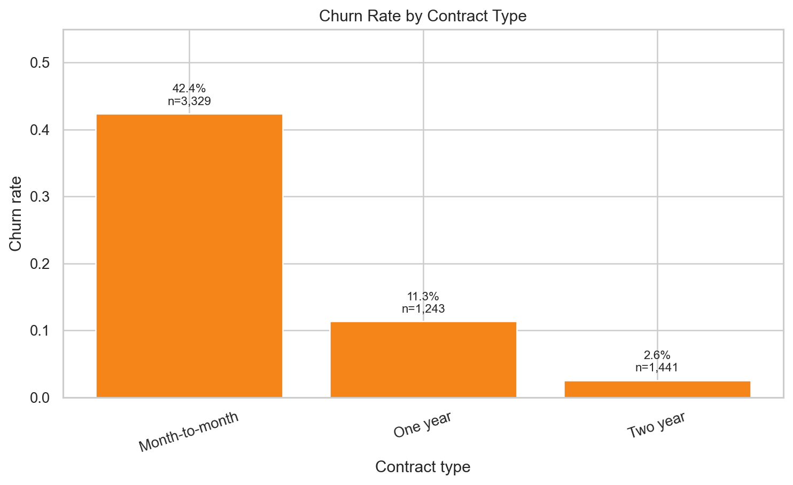
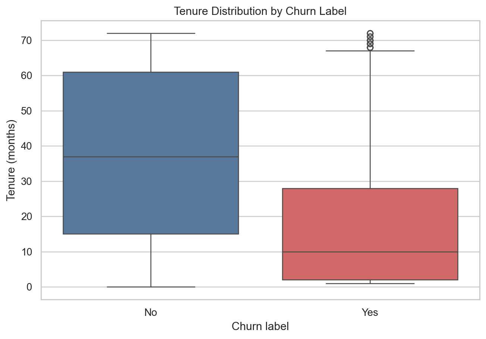
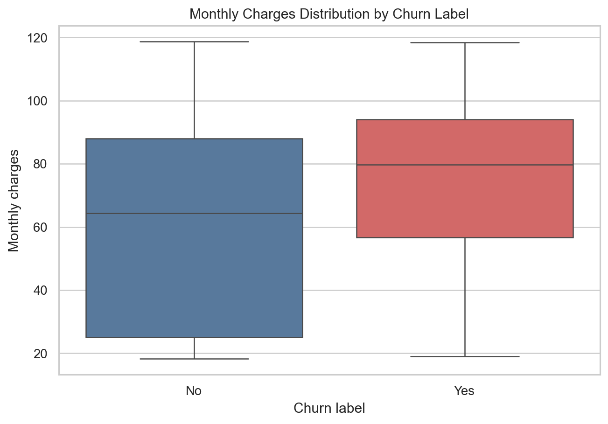
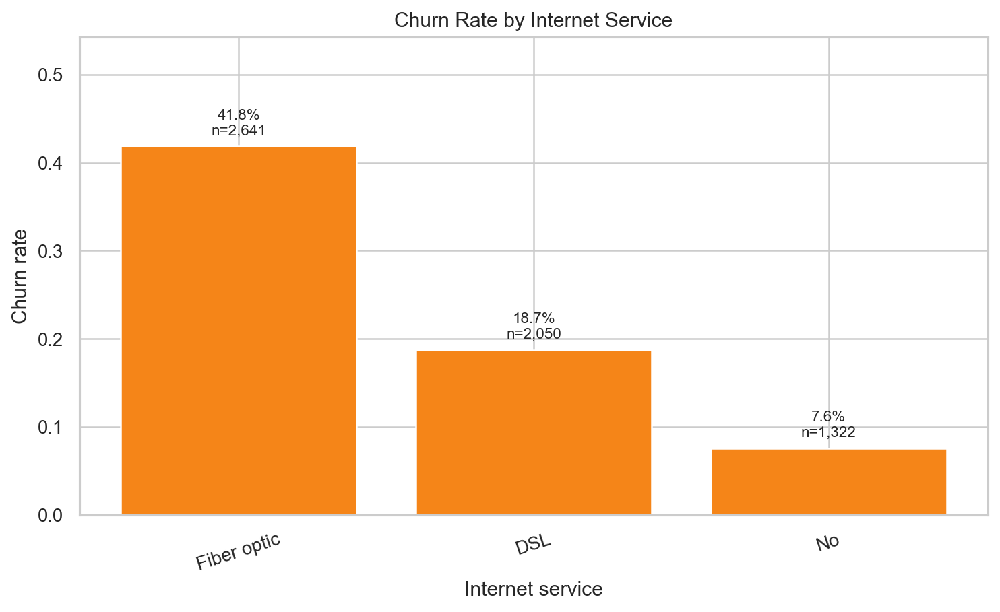
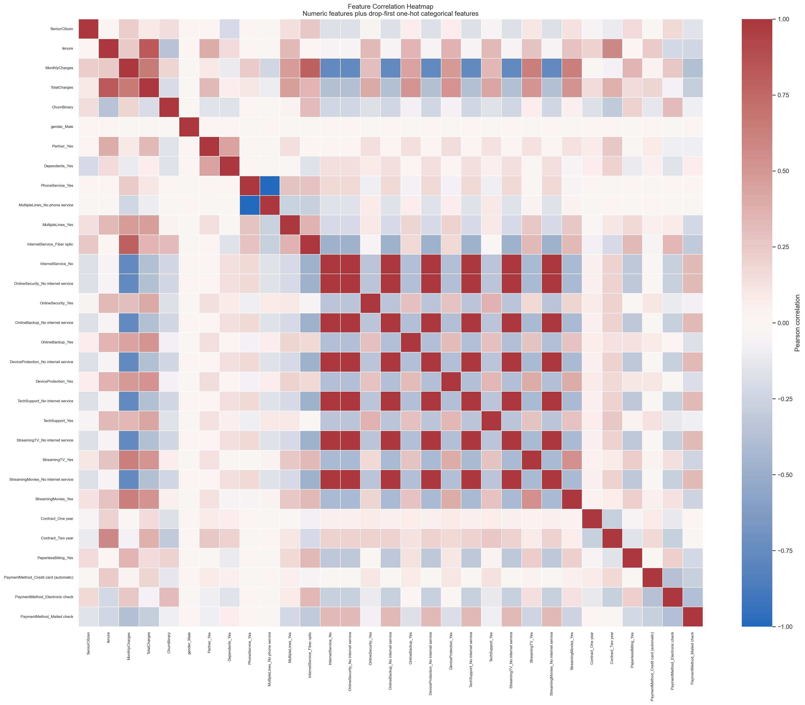

# A 数据工程师任务一与任务二结果

## 1. 工作范围

本交付只覆盖任务一探索性数据分析和任务二数据预处理。A 不训练或比较 GaussianNB、SVM、MLP、决策树、随机森林，也不生成最终实验报告。

## 2. 任务一结果 探索性数据分析

### 2.1 数据规模和字段核验

`data/telco_churn.csv` 实际读取为 **6014 行、21 列**，行列数、字段名称和字段顺序均与任务书一致。原始文件 SHA-256 为 `E96D3A2C6731334D0EC12197C564870D74B988477FA842AEFB847377785D4F15`。

- `customerID`、`gender` 的原始 `isna()` 计数为 0。
- 从 `SeniorCitizen` 到 `Churn` 的其余 19 个字段，原始 `isna()` 计数均为 1。
- 原因是文件最后一行只保留了 `customerID=5671-UUNXD` 和残缺的 `gender=Fem`，其余 19 个字段全部缺失。这不是全字段均空行，而是 **1 条严重不完整的截断记录**。
- 原始数据的全字段均空行是 0 条，完全重复行是 0 条，缺失 `customerID` 是 0 条，重复 `customerID` 也是 0 条。

### 2.2 隐藏空白值和类型异常

| 检查项 | 实际结果 | 处理判断 |
|---|---:|---|
| `TotalCharges` 原始类型 | `object` | 与累计费用的数值含义不一致，需要转换 |
| `TotalCharges` 原始 `isna()` | 1 条 | 来自文件末尾截断记录 |
| `isna()` 无法发现的纯空白字符串 | 9 条 | 去除首尾空格后规范为缺失值 |
| 非空文本数值转换失败 | 0 条 | 没有其他非法费用文本 |
| 数值转换后缺失 | 10 条 | 9 条空白费用加 1 条截断记录 |
| 其中 `tenure == 0` | 9 条 | 与新客户尚未产生累计费用的语义一致 |
| 其中 `tenure != 0` | 1 条 | 即缺少标签的截断记录 |

任务书提示的三个陷阱均已得到实际计数结论：`TotalCharges` 类型异常确实存在；9 个隐藏空白值不能由原始 `isna()` 直接发现；数据末尾不是严格的全空行，而是一条仅有两个残缺字段的截断记录。

完整逐列统计保存在 `outputs/eda/data_quality_summary.json`，本次真实运行日志保存在 `outputs/eda/eda_run.log`。

### 2.3 标签分布和不平衡程度

删除缺少 `Churn` 的截断记录后，EDA 使用 **6013 条有效记录**。

| Churn | 数量 | 比例 |
|---|---:|---:|
| No | 4424 | 73.57% |
| Yes | 1589 | 26.43% |

未流失与流失客户数量约为 **2.78:1**。标签存在明显不平衡：如果模型偏向多数类，准确率可能看起来较高，却漏掉大量真正流失客户。因此后续模型评估不能只看准确率，还应结合灵敏度、特异度和 AUC。本节只描述数据分布，不提前比较模型。



### 2.4 特征与流失的关系

#### 合同类型 Contract

| 合同类型 | 流失数 | 客户数 | 流失率 |
|---|---:|---:|---:|
| Month-to-month | 1411 | 3329 | 42.39% |
| One year | 141 | 1243 | 11.34% |
| Two year | 37 | 1441 | 2.57% |

月度合同组观察到的流失率最高，长期合同组更低。这是分组相关性，不能直接解释为合同类型导致流失。



#### 在网时长 tenure

| Churn | 样本数 | 平均值 月 | 中位数 月 | 最小值 | 最大值 |
|---|---:|---:|---:|---:|---:|
| No | 4424 | 37.43 | 37 | 0 | 72 |
| Yes | 1589 | 17.79 | 10 | 1 | 72 |

流失组的 tenure 中位数为 10 个月，未流失组为 37 个月；图中显示流失客户更多集中在较短在网时长区间。



#### 月费用 MonthlyCharges

| Churn | 样本数 | 平均值 | 中位数 | 最小值 | 最大值 |
|---|---:|---:|---:|---:|---:|
| No | 4424 | 61.21 | 64.40 | 18.25 | 118.75 |
| Yes | 1589 | 74.35 | 79.75 | 18.95 | 118.35 |

流失组的月费用中位数为 79.75，未流失组为 64.40；本数据中较高月费与流失呈正向描述性关联，但不能据此认定因果关系。



#### 网络服务 InternetService

| 网络服务 | 流失数 | 客户数 | 流失率 |
|---|---:|---:|---:|
| Fiber optic | 1105 | 2641 | 41.84% |
| DSL | 384 | 2050 | 18.73% |
| No | 100 | 1322 | 7.56% |

光纤服务组观察到的流失率最高。该差异还可能与月费、合同等特征共同相关，需要后续模型分析控制其他变量后再解释。



### 2.5 特征相关性热力图

热力图排除 `customerID`，纳入 4 个数值特征、二元 `ChurnBinary`，以及对 15 个类别特征执行 `drop_first=True` 后得到的哑变量。该编码用于全量描述性相关分析，不参与训练集和测试集的拟合。



绝对相关系数最高的预测特征对是：

- `PhoneService_Yes` 与 `MultipleLines_No phone service`：r = -1.000。
- 多个 `No internet service` 状态哑变量之间：r = 1.000。
- `InternetService_No` 与多个服务字段的 `No internet service` 状态：r = 1.000。

这些完全相关关系来自字段业务定义的冗余表达，说明 GaussianNB 的条件独立假设在这些特征上并不严格成立。它们可以用于解释后续 NB 的表现，但不能仅凭热力图判断 NB 一定优于或劣于其他模型。

## 3. 任务二结果 数据预处理

### 3.1 清洗规则和实际影响

| 步骤 | 规则 | 本次真实数据结果 |
|---|---|---:|
| 保护原始数据 | 所有处理在内存中完成 | 原始 CSV 哈希保持不变 |
| 字符串规范化 | 去除首尾空格，空字符串转缺失 | 识别 `TotalCharges` 空白 9 条 |
| 全空行处理 | 全字段为空才删除 | 0 条 |
| 缺少标签处理 | 无 `Churn` 无法参与监督学习 | 删除截断记录 1 条 |
| 完全重复行 | 逐字段一致才删除 | 0 条 |
| `customerID` 检查 | 缺失或重复时中止并要求人工核对 | 缺失 0，重复 0 |
| `TotalCharges` 转数值 | 非法文本转缺失并计数 | 非空转换失败 0 条 |
| 新客户累计费用 | `tenure == 0` 且费用缺失填 0 | 填 0 共 9 条 |
| 其他数值缺失 | 仅用训练集的中位数填补 | 实际剩余 0 条 |
| 其他类别缺失 | 仅用训练集众数填补 | 实际剩余 0 条 |
| 标签编码 | `No=0`、`Yes=1`，未知值报错 | 6013 个标签全部合法 |
| 标识字段 | `customerID` 不进入模型特征 | 已排除 |

清洗前为 6014 行，删除 1 条缺少标签且严重不完整的截断记录后为 **6013 行**。没有因为“看起来异常”而任意删除其他客户记录。

### 3.2 防止数据泄漏的处理顺序

实际顺序是：

1. 执行不依赖总体统计量的行级清洗，包括字符串规范化、截断记录识别、`TotalCharges` 数值转换和 `tenure == 0` 的确定性填 0。
2. 映射 `Churn`，删除 `customerID`。
3. 使用 `train_test_split(..., stratify=y, test_size=0.2, random_state=42)` 进行唯一一次划分。
4. 只用训练集拟合数值中位数和类别众数，再把同一规则应用于测试集。
5. 只用训练集确定类别水平，执行 `pd.get_dummies(..., drop_first=True)`；测试集按训练列名和顺序重排。
6. 只在编码后的 `X_train` 上调用 `StandardScaler.fit_transform()`，`X_test` 只调用同一 scaler 的 `transform()`。

### 3.3 分层划分结果

| 数据集 | 总数 | No 数量 比例 | Yes 数量 比例 |
|---|---:|---:|---:|
| 训练集 | 4810 | 3539 73.58% | 1271 26.42% |
| 测试集 | 1203 | 885 73.57% | 318 26.43% |

训练集和测试集的标签比例与全量有效数据基本一致，说明分层抽样生效。所有后续算法应直接复用这一划分，不能各自重新随机划分后比较结果。

### 3.4 编码 填补和缩放结果

- 删除标签和 `customerID` 后共有 19 个原始模型特征，其中数值特征 4 个、类别特征 15 个。
- `drop_first=True` 独热编码后，训练集和测试集均为 **30 个特征**，列名和列顺序完全一致。
- 测试集中不存在训练集未见类别，未知类别计数均为 0。
- 训练集拟合得到的数值中位数为：`SeniorCitizen=0`、`tenure=28`、`MonthlyCharges=70.3`、`TotalCharges=1387.125`。这些统计量没有使用测试集。
- `StandardScaler.n_samples_seen_ = 4810`，与训练样本数完全一致，证明 scaler 只在训练集上拟合。
- `X_train`、`X_test`、`X_train_scaled`、`X_test_scaled` 均不存在 NaN 或无穷值。
- 特征列清单保存在 `outputs/preprocessing/feature_names.txt`，全部处理元数据保存在 `outputs/preprocessing/preprocessing_summary.json`。

### 3.5 为什么必须先划分再缩放

`StandardScaler` 会从输入数据估计每个特征的均值和标准差。如果先用全量数据拟合 scaler，再划分训练集和测试集，测试集的分布信息就已经进入了训练阶段。这属于数据泄漏，会使测试结果偏乐观，无法代表模型面对真正新客户时的表现。

正确做法是先固定训练集和测试集，只在训练集上拟合均值和标准差，再使用同一个 scaler 转换测试集。交叉验证时也必须把 scaler 放进 `Pipeline`，让每一折只用该折训练部分拟合，避免折间泄漏。

### 3.6 为什么 NB 和树模型不缩放也能运行 而 SVM 和 MLP 必须缩放

**GaussianNB：** GaussianNB 分别估计每个类别下各特征的均值和方差。特征做线性缩放后，相应均值和方差也会同步变化，因此它通常不依赖各特征处于相同量纲。本项目按任务书要求让 GaussianNB 使用未缩放数据。

**决策树和随机森林：** 树模型通过“某特征是否小于某阈值”进行切分，主要依赖样本在单个特征上的相对顺序。标准化不会改变这种顺序，所以树模型通常不需要缩放。

**SVM：** 线性间隔、点积、欧氏距离和 RBF 核都会受到特征尺度影响。如果 `TotalCharges` 等大数值特征不缩放，它们会主导距离和间隔，掩盖较小尺度特征。按本任务规范，SVM 必须使用缩放数据。

**MLP：** 神经网络通过梯度下降更新权重。不同特征量纲差异过大会造成梯度不均衡、收敛缓慢或激活值进入不利区间。标准化可使优化更稳定、更容易收敛，因此本任务中的 MLP 必须使用缩放数据。

### 3.7 统一数据接口

```python
from src.data_engineering import prepare_data

prepared = prepare_data()
```

| 字段 | 内容 | 建议使用者 |
|---|---|---|
| `X_train` | 编码后、未缩放的训练特征 | GaussianNB、树模型、基线、交叉验证入口 |
| `X_test` | 编码后、未缩放的测试特征 | GaussianNB、树模型、基线 |
| `X_train_scaled` | 仅用训练集拟合 scaler 后的训练特征 | SVM、MLP |
| `X_test_scaled` | 使用同一 scaler 转换的测试特征 | SVM、MLP |
| `y_train` | 训练标签 | 所有模型 |
| `y_test` | 测试标签 | 所有模型 |
| `feature_names` | 30 个固定特征列名和顺序 | B、C 接口核对 |
| `scaler` | 只在训练集拟合的 `StandardScaler` | 缩放复核 |
| `metadata` | 清洗、划分、编码、填补和缩放追溯信息 | 结果审计 |

### 3.8 验证结果

实际执行：

```text
python -m unittest discover -s tests -v
Ran 9 tests ... OK

python -m src.data_engineering.eda --force
python -m src.data_engineering.preprocessing --force
训练=(4810, 30)，测试=(1203, 30)，scaler.n_samples_seen_=4810
```

9 项测试覆盖字段验证、隐藏空白、全空与截断行、`TotalCharges` 转换和填补、训练集统计量、未知标签、重复 ID、`customerID` 排除、列对齐、分层划分和缩放无泄漏。6 张 EDA 图均已实际生成并逐张目视检查。

## 4. 结果文件和提交限制

- 数据质量机器可读摘要：`outputs/eda/data_quality_summary.json`
- EDA 文字摘要：`outputs/eda/eda_summary.md`
- EDA 图表：`outputs/eda/01_*.png` 至 `06_*.png`
- 预处理元数据：`outputs/preprocessing/preprocessing_summary.json`
- 固定特征列：`outputs/preprocessing/feature_names.txt`
- 真实运行日志：`outputs/eda/eda_run.log`、`outputs/preprocessing/preprocessing_run.log`
- AI 使用记录：`reports/AI_USAGE.md`

本文件是 A 数据工程师对任务一和任务二的结果梳理，不是全组最终实验报告，也不包含模型成绩或业务上线结论。任务书原始提交物包含可运行 Notebook；本项目按用户要求不创建或维护 Notebook，最终提交前仍需确认教师是否接受 Python 脚本替代。
