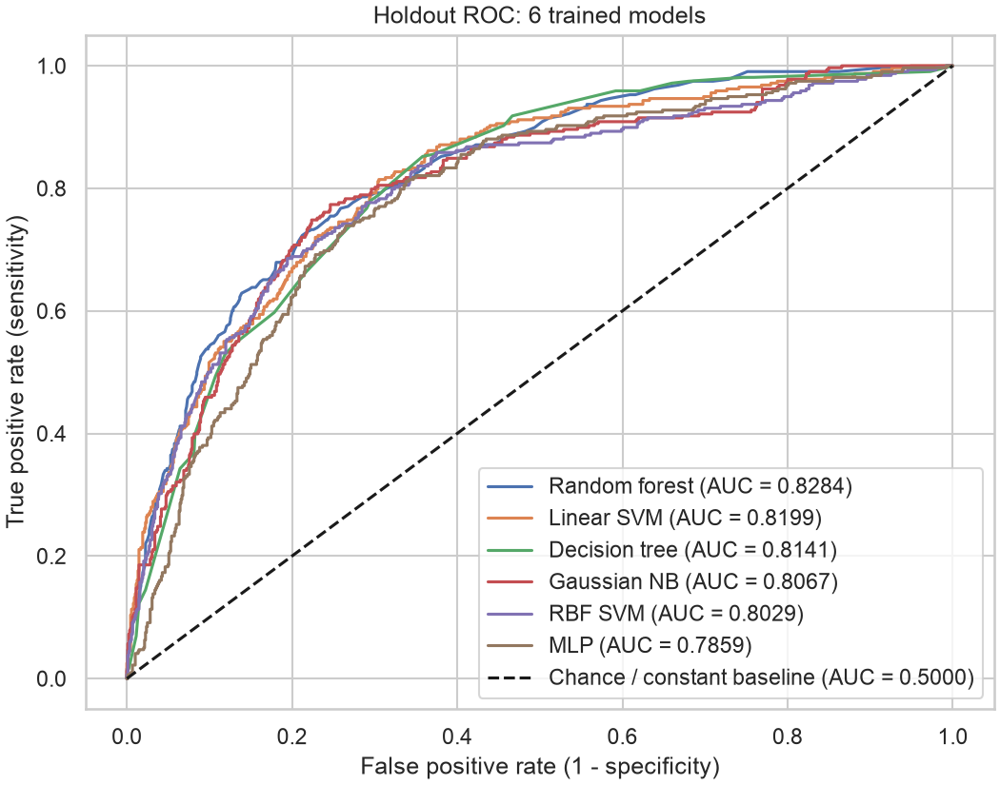

# 电信客户流失分类小组实验报告

A 数据工程 · B 算法工程 · C 集成与报告（邓闽川）｜2026-11-20

## 1. 结论先行

随机森林在共同留出集上 AUC 最高（0.8284）；线性 SVM 在训练集五折验证中平均 AUC 最高（0.8334），两种评估不足以支持某个模型稳定胜出。以控制误报为前提，默认随机森林可作为试点起点：在 318 名流失客户中识别 171 名，在 885 名不流失客户中误报 85 名。若以低成本触达提高覆盖率，随机森林加权可多识别 40 名流失客户，代价是多误报 76 名。

## 2. 比武成绩单

A 排查出 1 条缺标签的截断记录和 9 条在网时长为零的累计费用空白。清洗后 6,013 条中流失占 26.43%；月付合同组流失率为 42.39%，仅表示观察关联。固定种子 42 分层划分训练 4,810 条、测试 1,203 条，编码后 30 个特征。划分后才在训练集拟合填补、编码和缩放，避免测试分布参与训练。树按特征顺序分裂，GaussianNB 逐特征拟合分布，本实验不缩放这两类模型；SVM 的距离或内积及 MLP 的梯度优化受尺度影响，因此标准化。

| 模型（按测试 AUC 排序） | 准确率 | 灵敏度 | 特异度 | 测试 AUC | 五折 AUC 均值 ± 标准差 |
|---|---:|---:|---:|---:|---:|
| 随机森林 | 80.71% | 53.77% | 90.40% | 0.8284 | 0.8206 ± 0.0172 |
| 线性 SVM | 79.38% | 54.72% | 88.25% | 0.8199 | 0.8334 ± 0.0081 |
| 决策树 | 78.72% | 49.37% | 89.27% | 0.8141 | 0.8195 ± 0.0132 |
| 朴素贝叶斯 | 64.92% | 86.79% | 57.06% | 0.8067 | 0.8228 ± 0.0105 |
| RBF SVM | 79.55% | 50.00% | 90.17% | 0.8029 | 0.8018 ± 0.0178 |
| MLP | 75.98% | 55.03% | 83.50% | 0.7859 | 0.7623 ± 0.0198 |
| 全不流失基线 | 73.57% | 0.00% | 100.00% | 0.5000 | — |

ROC 使用流失分数，灵敏度和特异度来自硬分类；基线没有找出任何流失客户。决策树在训练集内选出深度 5；汇总五折评估时每个外折内部重新选深度，SVM/MLP 的缩放在各折 `Pipeline` 内拟合。五折复用 A 已编码的训练矩阵，不代表从 CSV 开始按折重做所有预处理。

## 3. 四个理论呼应点

1. **条件独立。** 训练集的 `tenure` 与 `TotalCharges` 相关系数约 0.82；在不流失、流失两类内分别约 0.79 和 0.95。这与 GaussianNB 的类内条件独立假设不符，相关特征可能重复计入证据；本次较高灵敏度（86.79%）伴随较低特异度（57.06%），但不能仅凭相关性断言误报来自这两个特征。
2. **核技巧。** RBF 用核函数隐式表示高维特征，让线性分隔对应到原空间的非线性边界；更灵活不等于泛化更好。本次固定参数下 RBF 测试 AUC 比线性核低约 0.0169，不能据此排除其它 `C`、`gamma` 的组合。
3. **神经网络。** MLP 训练损失由约 0.560 降至 0.184，在第 298 轮停止，尾段仍有波动；未跑满 500 轮不等于达到全局最优或验证集也已收敛。XOR 无法用一条直线分开，加入非线性隐层以后可以组合多个线性边界来表示 XOR。
4. **组合方法。** 随机森林平均多棵经自助抽样和随机选特征训练的树，降低预测误差的相关性，从而降低方差。本次森林测试 AUC 高于单树，但只有一次留出比较，且森林的五折标准差并未更小，不能把机制解释当作稳定性已经验证。

## 4. 业务建议

- 先用默认森林做小规模人工触达试点。森林加权使灵敏度从 53.77% 升到 66.35%、特异度从 90.40% 降到 81.81%；RBF SVM 加权多识别 79 名流失客户，同时多误报 158 名。低成本消息可试用加权方案；人工外呼或发券前，应以可承受误报量和预期挽留收益定阈值。
- 优先检查在网时长、月费与累计费用在高风险分群中的分布，测试不同触达策略。这三项在森林的重要性中排名靠前，但重要性不等于因果，也不意味着应直接调整价格。

## 5. AI 使用声明

| 环节 | 工具与关键提示词 | 产出及采纳 |
|---|---|---|
| A：EDA 与预处理 | Codex；“先划分后缩放”“训练集拟合”“`drop_first=True`” | 依据 A 的使用记录，辅助实现清洗、EDA 和预处理，并运行测试；C 复用 A 的接口。 |
| B：模型实现与训练 | ChatGPT / Codex；“完成 NB、线性核和 RBF 核 SVM、MLP” | 依据 B 的使用记录，生成训练模块并实跑；C 以逐条预测重算测试指标，保留交付参数。 |
| C：D/E、任务四和文档 | Codex；“在 A 的基础上完成 D 和 E”“继续把任务四完成”“写好如图要求的东西” | 生成并执行 C 模块、Notebook 和测试，整合 B、生成图表、编写本报告并整理 Git 交付。采用真实运行结果；未补写未经确认的个人修改或人工走查。 |

上述使用包含课程规范不允许的代码及报告生成，不声明其符合限制。最终提交前由组员核对采纳内容与课程要求。

## 6. 分工与走查记录

| 角色 | 负责模块 | 记录 |
|---|---|---|
| A | 数据质量、EDA、预处理 | 2026-11-20，预处理提交 `e6ad831e`；A 汇总 `8b570efe`。 |
| B | GaussianNB、两种 SVM、MLP | 2026-11-20，收到 B 交付及配置、损失曲线、逐条预测；未取得 B 的远程提交号。 |
| C 邓闽川 | D/E、任务四、集成与报告 | 2026-11-20，见 `feature/c` 分支提交记录。 |

**技术走查（2026-11-20，工具辅助）：** 在 A 的 `prepare_data_from_frame()` 核对先按标签划分，再对训练集拟合填补和缩放，测试集只做同规则转换。在 B 的 `train_models()` 核对 NB 使用未缩放矩阵、SVM/MLP 使用已缩放矩阵；同时验证数据哈希、特征顺序、训练/测试索引和测试标签与 A 一致，四项指标重算一致。邓闽川本人走查确认尚未记录。
